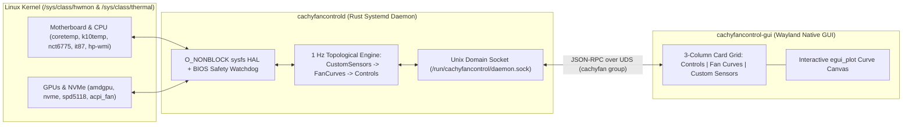

<div align="center">


# CachyFanControl

**High-Performance, Native Linux Fan Control Daemon & Wayland GUI for CachyOS and Arch Linux**

[](https://www.rust-lang.org/)
[](https://cachyos.org/)
[](https://wayland.freedesktop.org/)
[](LICENSE)

*Heavily inspired by [FanControl (getfancontrol.com)](https://getfancontrol.com/), engineered from the ground up in native Rust for Linux.*  
**Built by HearneLabs — fuelled by caffeine and hate.**

[Installation](#-quick-installation-cachyos--arch-linux) •
[Features](#-key-features) •
[Architecture](#-architecture) •
[Hardware Guide](docs/INSTALLATION_AND_HARDWARE_GUIDE.md) •
[Mathematical Spec](docs/ARCHITECTURE_AND_MATH.md) •
[Contributing](CONTRIBUTING.md)

</div>

---

## ⚡ Overview

**CachyFanControl** brings the iconic **3-column card-based workflow** (**Controls**, **Fan Curves**, and **Custom Sensors**) and advanced thermal control mathematics of Windows' [FanControl](https://getfancontrol.com/) natively to **CachyOS** and **Arch Linux**—without Wine, without .NET runtime overhead, and without compromising Linux hardware safety.

Architected as a privileged, ultra-lightweight `systemd` background daemon (`cachyfancontrold`) paired with a 60 FPS GPU-accelerated Wayland GUI (`cachyfancontrol-gui`), **CachyFanControl** talks directly to `/sys/class/hwmon` and `/sys/class/thermal` using non-blocking `O_NONBLOCK` I/O and guarantees that your fans are **always** returned to motherboard BIOS/firmware control (`pwmX_enable = 2`) if the daemon stops, reloads, or crashes.

---

## 🔥 Key Features

| Category | Capabilities |
| :--- | :--- |
| **🌀 Controls (Fans)** | Per-header enable/disable toggle, Curve vs. Manual `%` override, Paired RPM tachometer monitoring, `Start %` / `Stop %` zero-RPM support, **6-tick zero-RPM kickstart with `+3%/tick` stall boost**, asymmetric `Step Up` / `Step Down` (`%/s`) slew-rate limiting, `Offset %`, `Minimum %`, and **Resonant Avoid Regions** to skip acoustic hum RPM bands. |
| **📈 6 Native Fan Curve Types** | **Graph** (draggable piecewise linear points), **Auto** (dual-horizon OLS linear regression trend + integral creep PID controller), **Linear** (min/max temperature slope), **Mix** (`Max`, `Min`, `Average`, `Sum`, `Subtract` across multiple curves with live active-curve tracking), **Trigger** (dual-threshold Schmitt trigger), **Flat**, and **Sync**. |
| **🌡 Custom Virtual Sensors** | **Time Average** (sliding ring-buffer moving average that computes immediately on startup), **Mix Sensor** (`Max`, `Min`, `Average`, `Sum`, `Subtract` across CPU/GPU/NVMe sensors), **Offset Sensor** (additive `°C` or proportional `%`), and **File Sensor** (external path reader with 30-tick error backoff). |
| **🛡 Hardware Safety First** | Snapshots initial firmware states before touching any PWM register. Restores automatic BIOS control (`pwmX_enable = 2`) on control disable, `SIGINT`/`SIGTERM`/`SIGHUP`/`SIGQUIT`, Rust panic hook, and `systemd` `ExecStopPost=/usr/bin/cachyfancontrold --restore-bios`. |
| **🐧 Broad Linux HAL** | Supports standard `/sys/class/hwmon/hwmonX/pwmY` (`0..=255`), WMI `pwm1_enable`-only laptop controllers (e.g., `hp-wmi`), and ACPI thermal `Fan` cooling devices (`/sys/class/thermal/cooling_device*`), addressed by reboot-stable hardware IDs (`chip@device:channel`). |

---

## 🏗 Architecture



For a complete breakdown of the **Ordinary Least Squares (OLS) Linear Regression Trend + Integral Creep** math, **Hysteresis & Response Time** state machines, and **Topological Dependency Ordering**, see [**docs/ARCHITECTURE_AND_MATH.md**](docs/ARCHITECTURE_AND_MATH.md).

---

## 🚀 Quick Installation (CachyOS / Arch Linux)

### 1. Install Dependencies
```bash
sudo pacman -S --needed base-devel rust lm_sensors wayland libxkbcommon libglvnd
```

### 2. Build and Install with `makepkg`
```bash
git clone https://github.com/brisbinchicken/CachyFanControl.git
cd CachyFanControl
makepkg -si
```

### 3. Enable the Daemon & Launch the GUI
```bash
# Add your user to the 'cachyfan' group for passwordless socket access
sudo usermod -aG cachyfan $USER

# Enable and start the background hardware daemon
sudo systemctl enable --now cachyfancontrold.service

# Launch the Wayland-native GUI
cachyfancontrol-gui
```

> **Motherboard Super I/O & GPU Notes**:  
> Need to unlock `nct6775`, `nct6687d`, `it87`, `amdgpu`, or laptop fan headers? Check out the complete [**Installation & Hardware Configuration Guide**](docs/INSTALLATION_AND_HARDWARE_GUIDE.md) for `sensors-detect` instructions and kernel parameters (`acpi_enforce_resources=lax`, `amdgpu.ppfeaturemask=0xffffffff`).

---

## 🛠 CLI & Diagnostic Commands

```bash
# Print a single 1 Hz hardware & curve telemetry snapshot as JSON and exit cleanly
cachyfancontrold --once

# Immediately relinquish all fans back to motherboard BIOS/EC control (pwmX_enable = 2)
sudo cachyfancontrold --restore-bios

# Run the unit test suite across the workspace
cargo test --workspace
```

---

## 🧠 Inspiration, Tooling & Credits

- **Inspiration**: **CachyFanControl** was inspired by [**FanControl**](https://getfancontrol.com/) by **Rem0o**—hands down the gold standard for fan management on Windows. **CachyFanControl** is an independent, clean-room native Linux implementation written from scratch in Rust; it contains zero original FanControl source code or Windows binaries and is not affiliated with or endorsed by `getfancontrol.com`.
- **Tools Used**:
  - **Language & Runtime**: **Rust** (2021 Edition) for zero-cost abstractions, memory safety, and deterministic RAII hardware cleanup (`Drop`).
  - **GUI Framework**: [**`eframe` / `egui`**](https://github.com/emilk/egui) & [**`egui_plot`**](https://github.com/emilk/egui_plot) with native **Wayland** (`smithay-client-toolkit` / `winit`) and OpenGL (`glow`) rendering.
  - **Architecture & Interoperability Research**: **REA (Reverse Engineer Anything)** MCP analysis toolkit used to study high-level thermal control concepts (OLS linear regression trend detection, hysteresis deadbands, and topological curve ordering) and adapt them natively to Linux's `/sys/class/hwmon` subsystem.
  - **Linux Packaging**: Arch Linux `makepkg` (`PKGBUILD`), `systemd` service hardening, `sysusers.d`, `tmpfiles.d`, and `udev` rules tuned for **CachyOS**.

---

<div align="center">

**Built by HearneLabs — fuelled by caffeine and hate.**  
Released under the [MIT License](LICENSE).

</div>
