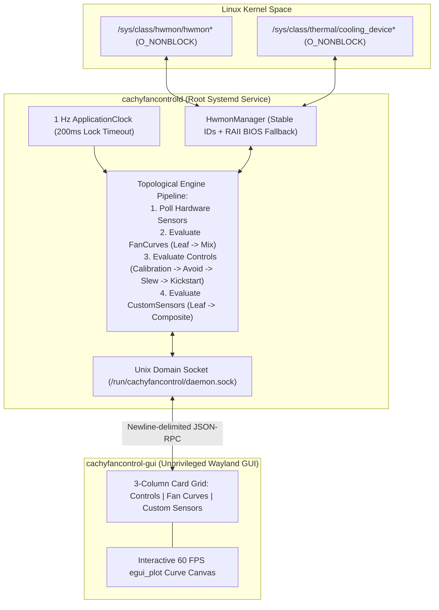

# CachyFanControl — Architecture & Mathematical Specification

This document details the internal architecture and mathematical control algorithms implemented in **CachyFanControl** (`cachyfancontrol-core`, `cachyfancontrold`, and `cachyfancontrol-gui`).

---

## 1. System Architecture (`cachyfancontrold` + `cachyfancontrol-gui`)

### Stable Hardware Addressing Across Reboots
Linux `hwmon` index numbers (`hwmon0`, `hwmon1`, ...) are assigned in module-probe order and frequently shift across reboots. `HwmonManager` resolves the underlying `/sys/class/hwmon/hwmonX/device` symlink target to construct deterministic IDs:
- `hwmon:<chip_name>@<device_id>:<channel>` (e.g., `hwmon:coretemp@coretemp.0:temp1`, `hwmon:nct6798@nct6775.656:pwm1`)
- `thermal:fan:<cooling_device>` (e.g., `thermal:fan:cooling_device0`)

---

## 2. Core Mathematical Algorithms

### A. Discrete Tick Counter (`ResponseTime`)
Each `ResponseTime` counter holds a threshold $V \ge 1$, an internal tick count $c$ (initially $0$), and a boolean `automatic_reset`:
$$\text{trigger}() \implies c \leftarrow c + 1, \quad \text{triggered} = (c \ge V)$$
If `automatic_reset` is enabled and $\text{triggered}$ is true, $c$ resets to $0$.

### B. Asymmetric Hysteresis & Response-Time Filter (`Hysteresis`)
Given upward deadband $H_{\uparrow}$, downward deadband $H_{\downarrow}$, upward response time $T_{\uparrow}$, downward response time $T_{\downarrow}$, and latched temperature $T_{\text{prev}}$:
1. On initial sample (or after reset), $T_{\text{prev}} \leftarrow T_{\text{cur}}$ and the filter triggers immediately.
2. If `is_at_limit && ignore_hysteresis_at_limits`, both `_up` and `_down` timers trigger.
3. If $T_{\text{cur}} - T_{\text{prev}} \ge H_{\uparrow}$, `_up.trigger()` is evaluated and `_down` resets.
4. If $T_{\text{prev}} - T_{\text{cur}} \ge H_{\downarrow}$, `_down.trigger()` is evaluated and `_up` resets.
5. Otherwise (inside deadband), both `_up` and `_down` timers reset to $0$.
6. Only when `_up` or `_down` fires does $T_{\text{prev}}$ update to $T_{\text{cur}}$ and allow the fan curve output to change.

---

### C. "Auto" Fan Curve — Dual-Horizon OLS Linear Regression + Integral Creep PID

Standard continuous PID controllers perform poorly on PC thermal sensors due to quantization noise causing derivative spikes and slow thermal soak causing integral windup. Instead, `Auto` curves use two **Ordinary Least Squares (OLS) linear regression trend detectors** over a circular buffer of size $N$:
- **Short Trend**: window size $N_s = 3R$, tolerance $\tau = 1.0^\circ\text{C}$
- **Long Trend**: window size $N_l = 5R$, tolerance $\tau = 1.0^\circ\text{C}$

#### 1. Exact OLS Slope Calculation
Over window $k \in \{0, 1, \dots, N-1\}$ (ordered from oldest sample $y_0$ to newest sample $y_{N-1}$), with precomputed constants $S_x = \sum k$ and $S_{xx} = \sum k^2$:
$$m = \frac{N \sum_{k=0}^{N-1} k \, y_k - S_x \sum_{k=0}^{N-1} y_k}{N S_{xx} - S_x^2}$$

#### 2. Half-Window Excursion & Integral Creep Accumulator (`creap`)
- **Fast Excursion**: If $\left|m \cdot \frac{N}{2}\right| > \tau$, the detector immediately reports `Trend::Up` ($m \ge 0$) or `Trend::Down` ($m < 0$).
- **Slow Creep Integration**: If $\left|m \cdot \frac{N}{2}\right| \le \tau$, the slope is integrated into an accumulator:
  $$\text{creap} \leftarrow \text{creap} + m$$
  Once $|\text{creap}| > \tau$, it resets $\text{creap} \leftarrow 0$ and fires `Trend::Up` or `Trend::Down`.

#### 3. Load Regime State Machine
- **Under-Load Threshold**:
  $$\text{IsUnderLoad}(T) \iff T \ge T_{\text{idle}} + 0.75 \cdot (T_{\text{load}} - D - T_{\text{idle}})$$
- **Step-Up Rule** (requires $R$ ticks via `response_up_time`):
  $$(\text{shortTrend} = \text{Up} \land T \ge T_{\text{load}} - D) \lor (T > T_{\text{load}}) \implies \text{cmd} \leftarrow \text{Clamp}(\text{cmd} + S, F_{\min}, F_{\max})$$
- **Step-Down Rule** (requires $2R$ ticks via `response_down_time`, stepping down at **half rate**):
  $$(\text{longTrend} = \text{Down}) \lor (T \le T_{\text{load}} - D \land \text{longTrend} = \text{Neutral}) \implies \text{cmd} \leftarrow \text{Clamp}\!\left(\text{cmd} - \frac{S}{2}, F_{\min}, F_{\max}\right)$$

---

### D. Control Loop: Calibration, Resonant Avoid Regions, Zero-RPM Kickstart & Slew Rate

1. **32-RPM Resolution Lookup & Resonant Avoid Regions (`Calibration`)**:
   - Forward RPM-to-PWM lookup uses bitshift indexing ($\lfloor \text{RPM} / 32 \rfloor = \text{RPM} \gg 5$) with 16-RPM half-bucket rounding.
   - Contiguous calibration points marked `Avoid = true` define an `AvoidRegion(Lower, Upper)`. When a target command enters `(Lower, Upper)`, it snaps to `Upper` when ramping up or `Lower` when ramping down so the fan never lingers at resonant acoustic frequencies.
2. **Stop Threshold & 6-Tick Zero-RPM Kickstart**:
   - Effective stop threshold:
     $$\text{stopThreshold} = \begin{cases} 0 & \text{if } \text{Start\%} \le 0 \\ \text{Stop\%} & \text{if } \text{Stop\%} \ne 0 \land \text{Stop\%} \ne \text{Start\%} \\ \text{Start\%} - 1 & \text{otherwise} \end{cases}$$
   - When waking a stopped fan ($\text{target} > \text{stopThreshold}$ while $\text{current} \le \text{stopThreshold}$ or $\text{RPM} = 0$), the controller commands $\max(\text{target}, \text{Start\%})$ for `6` ticks. If a paired tachometer still reads `0 RPM` after 6 ticks, the controller boosts the command by **`+3%` per tick** until rotation is established.
3. **Asymmetric Slew-Rate Limiter (`StepUp` / `StepDown`)**:
   $$\Delta = \text{Clamp}(\text{target} - \text{current}, \; -\text{StepDown}, \; +\text{StepUp})$$
   $$\text{next} = \text{Clamp}(\text{current} + \Delta, \; 0, \; 100)$$
   If $\text{next} \le \text{stopThreshold}$, output snaps cleanly to `0%`.
